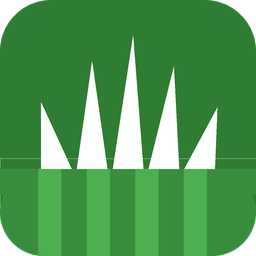
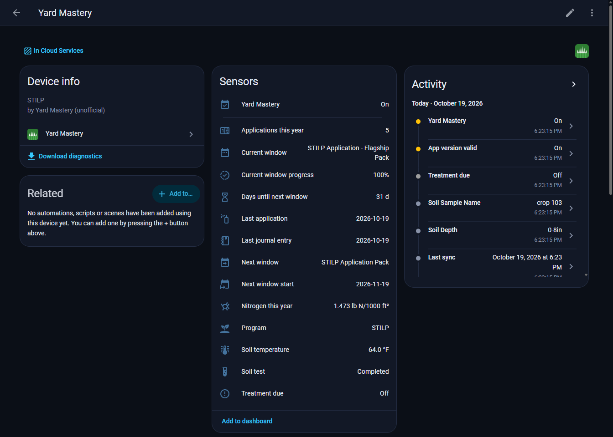
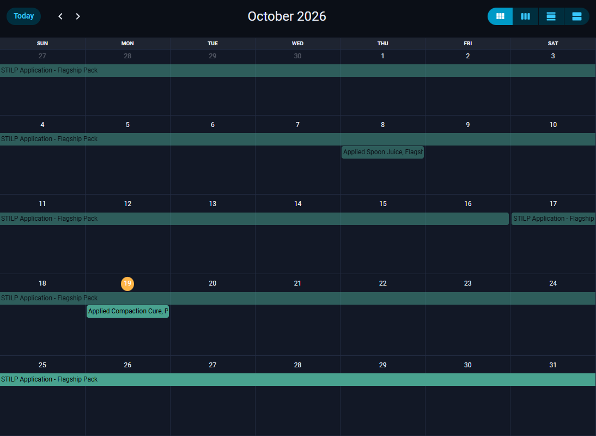
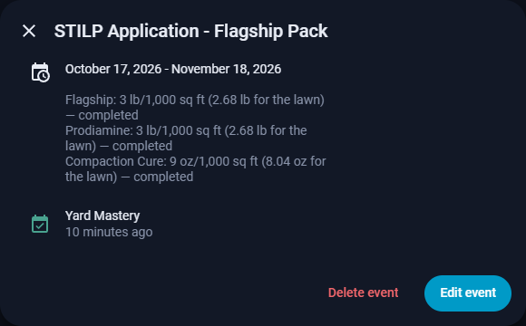
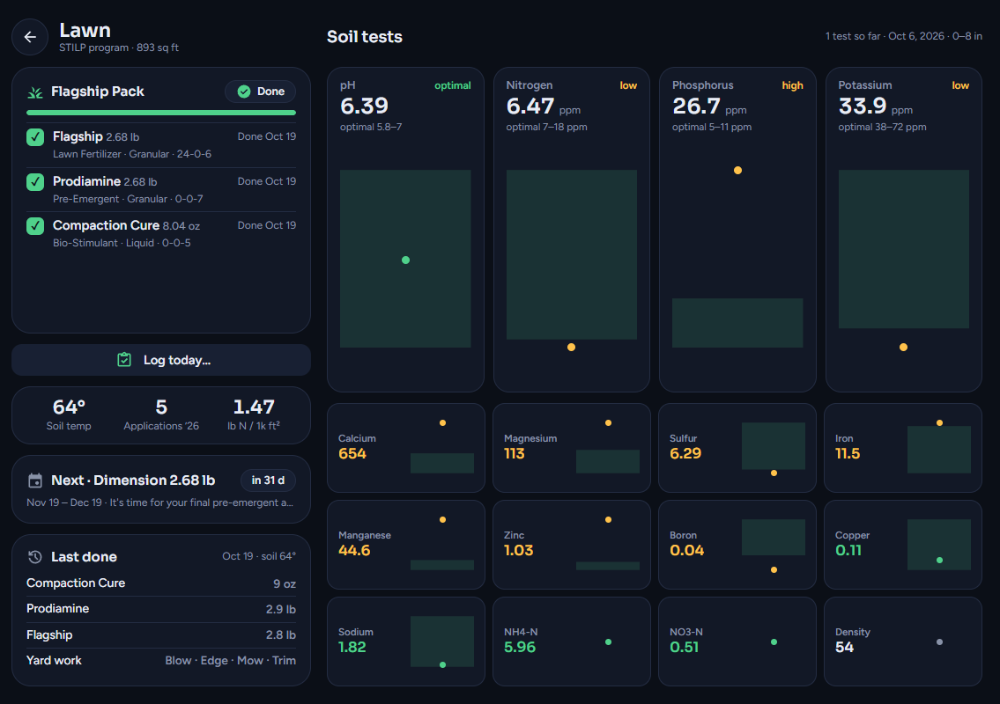
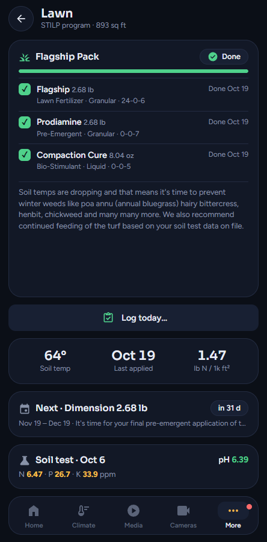

> ⚠️ **Personal project — not a professional developer.** These integrations were built for personal use via AI-assisted "vibe coding" (Claude). They work for my setup but may have rough edges. Use at your own risk, PRs welcome, and please be kind in issues.

<p align="center">
  
</p>

# Yard Mastery — Home Assistant Integration

[](https://github.com/hacs/integration)
[](https://github.com/Space-C0wboy/ha-yard-mastery/releases)
[](https://github.com/Space-C0wboy/ha-yard-mastery/actions/workflows/tests.yml)
[](https://github.com/Space-C0wboy/ha-yard-mastery/actions/workflows/validate.yml)
[](https://www.home-assistant.io/)
[](https://developers.home-assistant.io/docs/creating_integration_manifest/#iot-class)
[](LICENSE)

A [HACS](https://hacs.xyz/) custom integration for the [Yard Mastery](https://yardmastery.com) lawn-care app. It brings your lawn program into Home Assistant: treatment windows, your journal and reminders on a **calendar**, **sensors** for the current and next window, and **actions** to log what you did, so you don't have to open the app.

> [!CAUTION]
> **Unofficial.** This project is not affiliated with, endorsed by, or supported by Yard Mastery. It uses the same private web API the phone app uses, which is undocumented and may change or stop working without notice. Polling is deliberately slow — please be kind to their servers.

---

## Features

- **Your program on a calendar:** every treatment window (with each product's rate and the amount for your lawn), every journal entry, and your reminders — past and future.
- **Sensors for the lawn:** soil temperature, the current and next window, progress, a "treatment due" flag, last application, applications and nitrogen this season, soil-test values and lawn areas.
- **History, kept:** your whole history is imported on first setup. A built-in change log records *when* things changed ("when was that marked done?"), even though the app only shows the current state.
- **Log from Home Assistant:** applications, activities (mow, edge, aerate…), photos, item status and reminders — from dashboards, automations or Assist.
- **Safe by default:** writes are **off** until you turn them on. Nothing changes in Yard Mastery unless you (or an automation you wrote) call an action.
- **Light on the API:** a normal poll makes at most 10 requests; slow-changing data refreshes every 6 hours.
- **Private:** your login stays in Home Assistant, the diagnostics download is redacted, and nothing personal lives in this repository.
- **No extra dependencies:** uses only `aiohttp`, which is already bundled with Home Assistant.

---

## Screenshots

**The device and its sensors**



**Your program on the calendar** — each treatment window spans its dates, and journal entries show on the day you logged them. Open a window to see every product with its rate and the amount for your lawn.





**Example dashboard** — not part of the integration. A custom dashboard built on its entities: the current window as a checklist, a log button, and one chart per soil-test nutrient against the lab's optimal range.





---

## Entities

One device, **Yard Mastery**, with the program type as its model.

| Entity | Entity ID | State | Notes |
|--------|-----------|-------|-------|
| Soil temperature | `sensor.yard_mastery_soil_temperature` | °F (or °C) | 24-hour average for your ZIP |
| Program | `sensor.yard_mastery_program` | `STILP`, `DLUX`, … | Lawn type, square feet, product preference and program details as attributes |
| Current window | `sensor.yard_mastery_current_window` | Window name | Start, end, description and each product: item `id` (for `set_item_status`), rate, unit, amount for your lawn, N-P-K, status |
| Current window progress | `sensor.yard_mastery_current_window_progress` | % | Steps, completed, skipped, remaining |
| Next window | `sensor.yard_mastery_next_window` | Window name | Same attributes as the current window |
| Next window start | `sensor.yard_mastery_next_window_start` | Date | — |
| Days until next window | `sensor.yard_mastery_days_until_next_window` | Days | — |
| Treatment due | `binary_sensor.yard_mastery_treatment_due` | On / off | On while the current window still has items not done |
| Last application | `sensor.yard_mastery_last_application` | Date | Products and amounts, soil temperature, areas, notes |
| Last journal entry | `sensor.yard_mastery_last_journal_entry` | Date | Name, notes, activities, photo count |
| Applications this year | `sensor.yard_mastery_applications_this_year` | Count | — |
| Nitrogen this year | `sensor.yard_mastery_nitrogen_this_year` | lb N / 1,000 sq ft | Worked out from what you logged; P and K as attributes |
| Soil test | `sensor.yard_mastery_soil_test` | Test status | Test date, days old, recommended products, and `history`: every completed test, oldest first, as `{date, density, nutrients: {abbr: {value, low, high, status}}}` (`status` is `low`, `optimal` or `high`) |
| Calendar | `calendar.yard_mastery` | On while an event is happening | See [Calendar](#calendar) |

**Diagnostic entities:** one sensor per measured soil-test value (pH, N, P, K and organic matter are enabled; the rest are disabled by default); each carries `optimal` and `status` (`low` / `optimal` / `high`), one per lawn area (square feet), Dug AI turns, last sync, and **app version valid**.

> [!NOTE]
> **Nitrogen** only counts granular products (rates by weight). Liquid products are rated by volume and the app gives no density, so they are listed under the `not_counted` attribute instead of guessed.

> [!TIP]
> Big or private data — lawn polygons, the whole calendar, image carousels, the full lab report — is kept in Home Assistant's storage, not in entity attributes, so your database stays small. Download diagnostics to see it.

> **Note:** Entity IDs may vary if you have renamed entities. The names above are the defaults.

---

## Installation

### Via HACS (Recommended)

1. Open HACS → ⋮ → **Custom repositories**
2. Add `https://github.com/Space-C0wboy/ha-yard-mastery` with type **Integration**
3. Search for **Yard Mastery** and click **Download**
4. Restart Home Assistant

### Manual

1. Copy `custom_components/yard_mastery` into your `config/custom_components/` folder
2. Restart Home Assistant

---

## Configuration

1. Go to **Settings → Devices & services → Add integration**
2. Search for **Yard Mastery**
3. Sign in with your Yard Mastery email and password

> [!IMPORTANT]
> The first setup imports your history — every past year of your calendar, each journal entry and the details of every window. On an account with years of data this can take a while. Later polls are small.

### Options

**Settings → Devices & services → Yard Mastery → Configure**

| Option | Default | What it does |
|--------|---------|--------------|
| Allow changes to Yard Mastery | **Off** | Lets the actions, and reminder edits in the calendar, change your Yard Mastery data. Off means Home Assistant only reads. |
| App version to report | `4.00.05` | Sent with every request. See [If Yard Mastery retires the app version](#if-yard-mastery-retires-the-app-version). |
| Update interval (minutes) | `30` | 15 to 1440. Soil tests, lawn areas and next year's calendar refresh every 6 hours; reference lists daily. |

Changing an option reloads the integration.

---

## Calendar

`calendar.yard_mastery` shows three kinds of all-day events:

| Event | Shows |
|-------|-------|
| Program window | Each product's rate per 1,000 sq ft, the amount for your lawn, and whether it's done |
| Journal entry | What was applied (with amounts) or done, areas, soil temperature, notes, photo count |
| Reminder | Your reminder text |

With **Allow changes** on, you can create, edit and delete **reminders** from the calendar. Program windows and journal entries can't be edited there — use the [actions](#actions).

> [!WARNING]
> Deleting a reminder **dismisses** it in Yard Mastery, and that can't be undone.

---

## Actions

> [!IMPORTANT]
> With **Allow changes** off, every action except `refresh` and `import_history` fails with *"Changes to Yard Mastery are turned off in the integration's options"*. Every change is written to the logbook and the change log, then followed by a refresh. All actions take an optional `config_entry_id` (only needed with several accounts) and return what they changed.

| Action | What it does |
|--------|--------------|
| `yard_mastery.log_application` | Create or update the journal entry for a date (default today). Merges with an entry already on that day — existing applications, activities and photos are kept. |
| `yard_mastery.set_item_status` | Mark program items `done`, `skipped` or `not_done`, by `items` (ids) or by `products` in a `window`. See [below](#set_item_status). |
| `yard_mastery.log_activity` | Add `mow`, `edge`, `aerate`, `dethatch`, `blow` or `trim` to a date's entry, with optional `areas` and `notes`. |
| `yard_mastery.add_photo` | Attach a photo to a date's entry, from a camera or image entity (`entity_id`) or a `file`. |
| `yard_mastery.delete_journal_entry` | Delete an entry. A `date` or `entry_id` is required — there is no default. |
| `yard_mastery.create_reminder` / `update_reminder` / `dismiss_reminder` | The same reminder operations as the calendar. Reminder ids appear in the calendar events. |
| `yard_mastery.refresh` / `import_history` | Always available — they only read. |

### `log_application` amounts

- `products` is a list of `product` (name or id) and optional `amount`.
- `amount` is the **total amount applied over your whole lawn** — the same number the app records, not a per-1,000 sq ft rate.
- Leave `amount` out and the recommended total is used: rate × lawn size ÷ coverage. The lawn size is the one the app measured for your yard.
- Optional: `areas` (lawn area names), `notes`, `soil_temp` (defaults to today's ZIP soil temperature).

> [!WARNING]
> **Experimental:** calling `log_application` *without* `products` logs the current `window`'s open items at their recommended amounts and marks them done. This program-linked default hasn't been verified on a real application yet and may change. Name the products until then.

> [!NOTE]
> A `file` for `add_photo` must be under `/config` or `/media` and allowed by Home Assistant — its folder must be in [`allowlist_external_dirs`](https://www.home-assistant.io/integrations/homeassistant/#allowlist_external_dirs). Media folders are allowed by default.

### `set_item_status`

In the app an item is **done** because a journal entry has an application linked to it, so `done` and `not_done` work through the journal, the way ticking and un-ticking an item in the app does:

| Status | Open item | Skipped item | Done item |
|--------|-----------|--------------|-----------|
| `done` | Logs it on the `date`'s entry (default today), linked to the item, at the recommended whole-lawn amount or `amount` | Same as an open item | Nothing to change |
| `skipped` | Skips it | Nothing to change | Refused — set it to `not_done` first |
| `not_done` | Nothing to change | Unskips it | Removes its application from the entry it was logged on; other applications, activities and photos stay |

- `amount` is the total over the whole lawn (as for `log_application`) and only works when one item is targeted. If that day's entry already has the product, `done` links the item to it and keeps the amount recorded there.
- If `not_done` leaves an entry with nothing in it — no applications, activities, photos, areas, title or note text — the entry is deleted, as the app does. Otherwise it is saved.
- `amount` is refused when that day's entry already has the product — change that amount with `log_application`.
- Two items for the same product in one `done` call share one application on the entry, at the amount of the last of them.
- `done` defaults to today, even for a past window (the app uses an expired window's end date) — pass `date` to log it on another day.
- `not_done` also removes the notes the app writes when an item is ticked (*Completed …* / *Completing … - …*), as the app does.
- If a change is made of several steps (unskipping, then one journal entry per date) and one fails, the steps already made are kept, logged and recorded, and the error says which went through.
- `date` and `amount` are only for `done`. The response lists what happened to each item.

### Example: log what you spread today

```yaml
action: yard_mastery.log_application
data:
  products:
    - product: Flagship
      amount: 2.7
  areas: [Front Yard]
  notes: Watered in afterwards.
```

### Example: log a mow and edge

```yaml
action: yard_mastery.log_activity
data:
  activities: [mow, edge]
```

### Example: snap a photo for today's entry

```yaml
action: yard_mastery.add_photo
data:
  entity_id: camera.front_yard
```

### Example: skip a product in the current window

```yaml
action: yard_mastery.set_item_status
data:
  status: skipped
  products: [Prodiamine]
```

### Example: mark a program item done yesterday

```yaml
action: yard_mastery.set_item_status
data:
  status: done
  products: [Flagship]
  date: "2026-10-18"
```

### Example: a heads-up the evening before a window opens

```yaml
triggers:
  - trigger: calendar
    event: start
    entity_id: calendar.yard_mastery
    offset: "-6:00:00"
conditions:
  - condition: template
    value_template: "{{ 'Application' in trigger.calendar_event.summary }}"
actions:
  - action: notify.mobile_app_my_phone
    data:
      title: "Lawn window opens tomorrow"
      message: "{{ trigger.calendar_event.summary }}"
```

---

## If Yard Mastery retires the app version

Yard Mastery can stop accepting an old app version. When it does, **app version valid** turns off and a repair issue appears.

> [!TIP]
> Put a newer version in the integration's options (**App version to report**). How to find the current version is in [docs/api.md](docs/api.md#how-to-re-read-a-new-app-version).

---

## Data & Refresh

| What | How often |
|------|-----------|
| Soil temperature, current/next window, this year's calendar, account status | Every poll (default 30 min) |
| Lawn areas, soil tests and reports, next year's calendar, missing window details | Every 6 hours |
| Activity and program reference lists, app version check | Daily |
| Full history import | First setup, or `yard_mastery.import_history` |

A failed request is retried at most hourly, and a poll never makes more than 10 requests.

---

## Troubleshooting

| Problem | What to do |
|---------|------------|
| Reauth prompt | Your password changed, or sign-in failed repeatedly. Enter the current password. Home Assistant never retries in a loop (at most one re-login per 15 minutes). |
| Data looks stale | Call `yard_mastery.refresh`, or check the **last sync** sensor and its `last_error` attribute. |
| Actions fail with "turned off" | Turn on **Allow changes to Yard Mastery** in the options. |
| Repair issue about the app version | See [If Yard Mastery retires the app version](#if-yard-mastery-retires-the-app-version). |

### Diagnostics

Download diagnostics from the integration page to attach to an issue. They include the stored data and change log with personal information redacted: email, password, token, names, address, coordinates and lawn polygons, user id, soil-test barcode and lab ids, tracking details, and photo links.

> [!NOTE]
> Please still glance through diagnostics before posting them.

---

## Development

```bash
bash scripts/test.sh
```

Tests run in Docker (Python 3.14). API notes are in [docs/api.md](docs/api.md).

---

## License

MIT — see [LICENSE](LICENSE). Yard Mastery and the Yard Mastery app belong to their owners.
